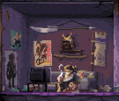

  

---

Olá, eu sou o André, tenho 16 anos e sou de São Paulo. Atualmente cursando técnico de desenvolvimento de sistemas na ETEC, e estou sempre buscando melhorar meu conhecimento.

<h3 align ="left">Linguagens e Ferramentas<h3/>

          

 
 
 

## Estatísticas

 
 
  

